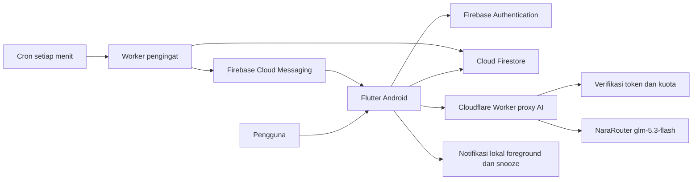

# Ruma — urutan persiapan dan implementasi

> Tahap Asisten 19 Oktober 2026 selesai: draf gabungan agenda + transaksi, tinjauan/edit/keluarkan item, dan penyimpanan atomik aktif. Rules terbit 22.52 WIB; uji SDK/UI HP dan satu panggilan AI produksi lulus, fixture dibersihkan, APK normal dipasang. Draf masih dalam memori dan jam agenda disunting manual. Status/batas: [ASSISTANT-IMPLEMENTATION.md](ASSISTANT-IMPLEMENTATION.md).

> Tahap keuangan 19 Oktober 2026: form, repository, anggaran, riwayat, laporan dan Beranda sudah diimplementasikan. Rules gabungan aktif dan uji SDK Android lokal/produksi lulus; fixture dibersihkan dan APK normal dipasang. Status/bukti terbaru: [FINANCE-IMPLEMENTATION.md](FINANCE-IMPLEMENTATION.md).

> Pembaruan 19 Oktober 2026, tahap agenda: CRUD manual sekali jalan dan Rules per UID sudah aktif; suite Android emulator dan produksi lulus, fixture produksi dibersihkan. Lihat [AGENDA-IMPLEMENTATION.md](AGENDA-IMPLEMENTATION.md) untuk bukti, batas dan APK terbaru. Berikutnya keuangan manual; seri mingguan, agent dalam aplikasi dan notifikasi belum selesai.

> Status pengembangan 19 Oktober 2026: fondasi Flutter Android dan Firebase Auth lulus uji emulator serta produksi pada HP. APK pratinjau telah dipasang. Bukti dan batas implementasi terkini ada di [FLUTTER-FOUNDATION.md](FLUTTER-FOUNDATION.md) dan [DEVELOPMENT-LOG.md](DEVELOPMENT-LOG.md). Pernyataan “belum dibuat” pada riwayat di bawah menggambarkan tahap perencanaan sebelumnya.

19 Oktober 2026 · dokumen ini merekam rencana sebelum implementasi aplikasi. **Pengguna sudah meminta penyiapan dan uji layanan**; kondisi aktual dicatat pada [SETUP.md](SETUP.md). Proxy cloud sudah terdeploy; JWT/AI/kuota berhasil, CPU awal belum memenuhi nominal Free. Fondasi Flutter/Auth dan APK pratinjau sudah selesai; data manual, agent dan notifikasi masih tahap berikutnya. Bagian yang menyebut pekerjaan belum dijalankan di bawah adalah kondisi saat rencana dibuat; ikuti SETUP untuk status terbaru.

## Acuan dan urutan baca

1. [PRD](PRD.md): fitur, masalah pengguna, dan batas produk.
2. [Arsitektur](ARCHITECTURE.md): layanan yang dipilih dan asumsi biaya.
3. [Firebase/data](FIREBASE-DATA.md): akun, koleksi, aturan bisnis, akses dan offline.
4. [Agent/proxy](AGENT-PROXY.md): tool, persetujuan, kontrak endpoint dan batas penggunaan.
5. [Notifikasi](NOTIFICATIONS.md): FCM otomatis, penjadwal dan pelengkap lokal.
6. [Peta layar](SCREEN-MAP.md): 71 frame → 27 jenis halaman, dialog/sheet/keadaan bersama.
7. [Penerimaan](ACCEPTANCE.md): skenario sintetis, gerbang teknis dan uji mahasiswa.

## Gambaran sistem

Firestore adalah database utama; Worker tidak menjadi database kedua. Agent mengusulkan, aplikasi memvalidasi, dan pengguna menyetujui. Pengirim push tidak memerlukan AI untuk memeriksa waktu pengingat.

## Struktur Flutter yang direncanakan

Gunakan UI + data/repository dengan model Dart sederhana dan ChangeNotifier per alur yang membutuhkan state. Constructor injection cukup; tidak membuat interface untuk satu implementasi, framework agent, vector database, state library besar, atau lapisan use-case per tombol.

Struktur konseptual: `lib/app` untuk startup/routing/theme; `lib/data` untuk model/repository Firebase dan berkas draf; `lib/features` untuk auth, home, agenda, assistant, finance, profile, notifications; `lib/ui` untuk komponen bersama. Folder app/data/auth/home/profile/ui sudah dibuat; folder fitur tambahan mengikuti tahap implementasinya.

Repository konkret: akun/profil, agenda, keuangan, draf/operasi, percakapan dan notifikasi. Fungsi slot, recurrence, parsing rupiah dan proyeksi laporan dipisahkan dari widget agar dapat diuji tanpa memanggil AI. Validasi yang sama dipakai form dan tool agent. MainShell menjaga lima tab; halaman detail/form memakai Navigator dan argumen terstruktur, tidak membutuhkan router web.

## Package yang direncanakan

| Kebutuhan | Kandidat minimum | Catatan |
|---|---|---|
| Firebase | firebase_core, firebase_auth, cloud_firestore, firebase_messaging | SDK produk yang dipakai |
| Request Worker | http | Tidak perlu SDK OpenAI khusus untuk endpoint proxy |
| Aset dan format | flutter_svg, intl | SVG persegi; format rupiah dan tanggal Indonesia |
| Waktu | timezone, flutter_timezone | Zona IANA dan recurrence; tidak membuat form zona kustom |
| Notifikasi lokal | flutter_local_notifications | Foreground FCM dan snooze |
| Draf privat | path_provider + dart:io/dart:convert | Berkas draf, bukan ledger SQLite kedua |
| Pengujian | flutter_test, integration_test; Firebase Emulator Suite | Tambahkan saat tahap implementasi |

Versi paket fondasi telah dikunci di pubspec.lock. Paket fitur lain dipasang saat diperlukan, sesuai versi Flutter/Android yang dipakai. Grafik laporan memakai widget/painter sederhana terlebih dahulu. App Check dicatat untuk uji release, bukan dependency yang otomatis dianggap siap.

Worker memakai TypeScript, native fetch/Web Crypto, secret bindings dan Cron Trigger. Tidak memerlukan Express, VPS, atau Firebase Functions. Pilih validator schema yang paling kecil dan dapat dibuktikan benar setelah benchmark; tidak menghapus validasi untuk mengejar CPU Free.

## Kondisi lingkungan yang telah ditemukan

Pemeriksaan read-only sebelumnya menemukan Flutter 3.47.7 stable / Dart 3.13.5. Environment Android menunjuk `/opt/android-sdk` yang belum lengkap, sedangkan SDK yang berisi platform/build-tools/licenses tersedia di `/home/ael/Android/Sdk`. JAVA_HOME menunjuk JDK 27; JDK 17 juga tersedia. Firebase CLI dan FlutterFire CLI belum ditemukan saat pemeriksaan.

Sebelum implementasi, verifikasi ulang kondisi tersebut lalu pilih SDK/JDK sesuai panduan Flutter/Gradle terkini pada lingkup proyek/sesi. Jangan mengganti toolchain global proyek lain tanpa kebutuhan. Belum menjalankan flutter doctor, flutter create, pub get, perubahan env, pemasangan CLI, atau build pada tahap rancangan.

## Urutan eksekusi berikutnya

**Status terbaru, 19 Oktober 2026:** tahap 2, Auth, agenda manual sekali jalan dan keuangan manual dari tahap 3 selesai; berikutnya agent percakapan/draf/persetujuan. Seri/pengecualian dan undo masih menyusul. Pemeriksaan nominal CPU bukan penghalang tahap ini; ikuti pemicu pada [CPU-FOLLOWUP.md](qa/CPU-FOLLOWUP.md). Rules dan notifikasi tetap diuji pada tahap fiturnya masing-masing.

| Tahap | Pekerjaan | Bukti selesai |
|---|---|---|
| 0. Konfirmasi konfigurasi publik | Tentukan Android application ID, Firebase project ID/lokasi, Worker name, akun penyedia dan batas biaya AI | Lembar konfigurasi terisi tanpa secret |
| 1. Uji risiko integrasi | Model/tool calling, CPU Worker+JWT/kuota, pengirim FCM+cron, batch maksimum+Rules | Bukti gate T01–T04; jika gagal, revisi terkecil dahulu |
| 2. Fondasi Flutter | Scaffold, tema/aset, komponen, lima tab, routing, validasi dasar | Aplikasi berjalan di HP; bukan screenshot statis |
| 3. Akun dan data manual | Auth, Rules/index, agenda/seri/pengecualian, transaksi, anggaran, laporan, receipt/undo | Alur manual lengkap dan data per akun aman |
| 4. Agent | Proxy terverifikasi, tool baca/slot/draf, klarifikasi, tinjauan dan simpan gabungan | Skenario utama serta kegagalan/urungkan lulus |
| 5. Push dan pengingat | Registrasi token, cron, antrean, retry, tap routing, snooze | FCM nyata saat aplikasi tertutup, perubahan jadwal dan akun diuji |
| 6. Rapikan dan uji mahasiswa | UI nyata, aksesibilitas, usability form vs AI | Temuan dicatat dan masalah utama diperbaiki |
| 7. APK pengumpulan | Release signing, instal/update, cek secret, README demo dan dokumentasi | APK release dapat dipasang; konfigurasi sensitif tidak dibagikan |

Tahap 0 telah menyiapkan identitas, layanan, SDK dan Secret. Akses server disetujui, proxy terdeploy dan cap global 10/hari UTC aktif. Tahap 1 membuktikan protokol model, lima kasus agent, batas output, create-batch/kuota emulator serta JWT/AI/kuota cloud. CPU awal build produksi 13 ms vs nominal 10 ms dicatat sebagai [tindak lanjut ditunda](qa/CPU-FOLLOWUP.md) atas keputusan pengguna 19 Oktober 2026; ini tidak menghalangi tahap 2 dan dikerjakan kembali jika uji aplikasi menunjukkan error terkait CPU; seluruh path Rules, FCM dan HP tetap tertunda. Biaya/paket provider di luar cap uji belum ditentukan.

## Rencana waktu sekitar enam minggu

Deadline persis belum diberikan; ini urutan kerja untuk waktu sekitar 1,5 bulan, bukan tanggal pengumpulan yang dibuat-buat.

- Minggu 1: gate integrasi, fondasi Flutter, Auth dan Security Rules.
- Minggu 2: agenda/seri, transaksi, anggaran, ringkasan dan laporan manual.
- Minggu 3: tool agent, satu tinjauan gabungan, atomik, retry dan urungkan.
- Minggu 4: FCM/cron, izin, background, pergantian akun dan keandalan data.
- Minggu 5: pilot mahasiswa serta perbaikan alur/visual.
- Minggu 6: pengujian regresi, release APK, dokumentasi dan buffer.

Kerjakan potongan lengkap yang dapat diuji, bukan semua UI dahulu lalu baru mencoba model/FCM di akhir. Tidak menambah fitur baru selama alur inti belum lulus.

## Informasi yang belum tersedia

| Informasi | Status / perlakuan |
|---|---|
| Android application ID dan namespace | id.ruma.app sudah terdaftar; sumber Flutter belum dibuat |
| Firebase project ID, lokasi database, dan apakah proyek sudah ada | mobile-app-3479f dipilih pengguna dan dikhususkan untuk Ruma; database Jakarta sudah dibuat |
| Akun Cloudflare dan nama Worker | ruma-api terdeploy; URL dan versi pada konfigurasi publik/laporan cloud |
| Paket/kuota NaraRouter dan batas global harian | Belum diketahui; jangan menjanjikan panggilan AI gratis/tanpa batas |
| Secret provider pengganti dan service account | Keduanya terpasang privat di Worker; identitas khusus Datastore User aktif, tanpa Owner/Editor/FCM |
| HP uji, versi Android, tanggal deadline persis | Belum dicatat; tentukan sebelum rencana eksekusi final |

## Posisi saat berhenti sebelum coding

**Selesai sebagai rancangan:** pilihan layanan, scope, domain data, aturan akun/offline, tool/draf agent, desain antrean FCM, peta layar, fixture dan kriteria pengujian.

**Sudah diperiksa:** konfigurasi layanan, SDK Firebase, lisensi/toolchain Android, protokol model, lima sampel agent setelah perbaikan, batas output dan potongan proxy/Rules lokal. **Masih perlu dibuktikan:** keandalan agent lebih luas, CPU jalur awal Worker (IAM/JWT/kuota cloud sudah teruji), Rules seluruh fitur, kompatibilitas dependency aplikasi, permission/push HP serta build APK. Rincian hasil dan pekerjaan berikutnya ada di SETUP. Tidak perlu membuat PDF baru atau mengubah canvas untuk tahap ini.

## Referensi

- [Flutter architecture recommendations](https://docs.flutter.dev/app-architecture/recommendations)
- Referensi Firebase, Worker dan provider dicantumkan pada masing-masing spesifikasi.
