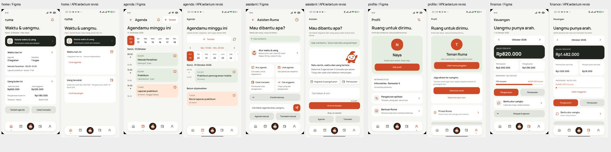

# Ruma - audit realisasi Figma terhadap Flutter

19 Oktober 2026. **Brand dasar sudah mengikuti Figma, tetapi implementasi belum setara dengan seluruh rancangan.** Beranda dan Profil paling banyak disederhanakan; kemampuan Asisten masih create-only. Perapian teks terbaru sengaja menyimpang dari keterangan panjang Figma sesuai permintaan pengguna.

## Sumber dan batas pemeriksaan

- File: [Ruma di Figma](https://www.figma.com/design/FE73TkpfpJrSuEX97IdrTX/Study-Match?node-id=42-53). Page `42:53` berisi 71 frame bernama `Prototype / ...`; inventaris dan properti tersimpan di `qa/figma-comparison/reference.json`. Ada lima page dalam file, dibaca lewat `use_figma` karena metadata awal hanya menampilkan page pertama.
- Lima layar dibandingkan secara visual: Beranda `44:9131`, Agenda `44:9165`, Asisten `44:11622`, Profil `130:20708`, Keuangan `146:19711`. Screenshot Figma di folder `qa/figma-comparison/`.
- Teks empat frame lain dibaca: welcome `44:53`, taskAdd `44:9365`, budgetReport `146:20051`, combinedDraft `281:4972`. Metadata teks dapat mencakup varian tersembunyi; bukan berarti semua teks terlihat sekaligus.
- Pembanding Android adalah screenshot native terakhir di `qa/ui-polish`, sebelum revisi teks/kartu terbaru. Revisi terbaru diverifikasi melalui kode, 27 uji lokal, analyzer dan render `qa/ui-copy`; **belum diverifikasi native**, karena pengguna menunda USB. Perbedaan nominal/nama/tanggal data sintetis tidak dihitung sebagai ketidaksesuaian desain.
- Figma diperiksa baca-saja; tidak mengubah kanvas. URL unduhan screenshot biasa memberi respons kosong; gambar bukti diperoleh lewat render node `use_figma`, bukan dari berkas kosong.
- Ketersediaan fitur dinilai dari jalur kode dan laporan tahap Auth/Agenda/Finance/Asisten sebelumnya, bukan uji produksi baru pada sesi audit ini. Tidak menghitung persentase “selesai” dari jumlah frame: banyak frame adalah state/dialog dari fitur yang sama.

## Temuan visual utama

| Bagian | Sesuai | Perbedaan aktual dan dampak |
|---|---|---|
| Brand | Manrope, warna latar #F6F7F3, judul 28/700, identitas oranye/sage, aset dan maskot | Sudah satu identitas; belum berarti semua tata letak identik. |
| Navbar | Lima ikon, Beranda paling kiri, Asisten di tengah, Profil paling kanan | Aman sebagai fondasi. Area aman/status bar mengikuti Android asli, bukan status bar gambar dari Figma. |
| Beranda | Judul dan CTA Asisten, dua topik waktu/uang | Figma menampilkan agenda+deadline, kegiatan terdekat, saldo+sisa anggaran dan aksi cepat. Flutter baru jumlah kegiatan serta saldo/pengeluaran dalam teks, dengan kartu minHeight 152 yang menyisakan ruang kosong. Ini prioritas visual tertinggi untuk tahap selanjutnya; audit ini tidak menambahkan fitur tersebut. |
| Agenda | Mingguan, timeline, warna kuliah/tugas | Tambah dipindah ke bawah judul dan ada reload; header tab Flutter 15 sedangkan Figma 22. Slot hari mengikuti target sentuh minimal dan bisa bergulir; Figma muat tujuh hari sekaligus. Data lokasi/seri belum sepadan. |
| Asisten | Maskot, input, akses manual, tinjauan draf | Figma punya empat pintasan kemampuan; Flutter memakai contoh pesan dan dua tombol manual agar tidak menawarkan kemampuan yang belum tersedia. Kartu lama terlalu tinggi; revisi terbaru merapatkan teks+maskot dan memindah detail ke informasi. |
| Keuangan | Periode, kartu saldo gelap, pemasukan/pengeluaran, anggaran dan aksi | Paling dekat di antara halaman operasional. Kartu/spacing membuat riwayat & laporan berada lebih bawah; label dan progress budget tidak persis sama. Setelah copy diringkas, kepadatan perlu dikonfirmasi di perangkat. |
| Profil | Avatar inisial, identitas, edit dan privasi | Flutter baru nama dan akun; bio, studi, avatar picker, pengaturan dan bantuan pada Figma belum terwujud. Kartu tautkan email untuk akun sementara adalah kebutuhan auth aktual yang tidak sama dengan contoh profil terdaftar Naya di Figma. |
| Form/picker | Field dan komponen bersama | Form dibuat satu alur sederhana dan picker Material; Figma memiliki langkah Cari waktu dan beberapa mode yang belum aktif. Copy singkat adalah revisi yang disetujui, bukan kesalahan salin. |
| Laporan/draf | Angka dari catatan aktual dan item draft yang dapat ditinjau | Figma menjanjikan waktu otomatis serta pembahasan laporan via AI; jam draf Flutter masih manual, laporan AI belum aktif. Jangan menyalin klaim tersebut sebelum backend/agent mendukungnya. |

## Prioritas yang direkomendasikan, belum dikerjakan oleh audit ini

1. Padatkan Beranda menggunakan data yang sudah ada: agenda terdekat/deadline, nominal saldo/pengeluaran dan sisa anggaran sebagai elemen yang mudah dipindai. Hindari kartu tinggi berisi satu paragraf. Ini tidak memerlukan penambahan banyak route.
2. Sepakati lingkup agent: penentuan jam kosong serta baca/edit/hapus catatan lama benar-benar belum aktif. Pilih satu tahap berikutnya sebelum menampilkan seluruh pintasan Figma.
3. Lengkapi Profil sesuai prioritas pengguna, dengan membedakan edit nama/akun yang sudah bekerja dari informasi studi/avatar/preferensi yang belum ada.
4. Notifikasi dan pengulangan memerlukan implementasi nyata; tidak selesai hanya dengan menyalin frame atau menyiapkan Firebase.
5. Setelah perangkat tersedia, periksa versi copy ringkas, pasang APK normal, lalu perbarui PDF. Jangan memperlakukan PDF lama sebagai hasil revisi terbaru.

## Pemetaan 71 frame

“Tersedia” berarti padanan fungsi inti ada, termasuk state dalam route yang sama. “Sebagian” berarti subset tersedia. “Belum” berarti belum ada alur setara. Tabel ini bukan klaim pixel-perfect atau pengujian baru atas setiap state.

Ringkasan inventaris: 33 tersedia, 12 sebagian, 26 belum. Tidak mengubah jumlah frame Figma.

| Frame Figma | Status | Realisasi / batas |
|---|---|---|
| [welcome](https://www.figma.com/design/FE73TkpfpJrSuEX97IdrTX/Study-Match?node-id=44-53) | Tersedia | Sambutan dan pilihan sesi/akun; ilustrasi memakai aset Ruma. |
| [signin](https://www.figma.com/design/FE73TkpfpJrSuEX97IdrTX/Study-Match?node-id=44-82) | Tersedia | Firebase email/password; form dan error pada halaman yang sama. |
| [signup](https://www.figma.com/design/FE73TkpfpJrSuEX97IdrTX/Study-Match?node-id=44-128) | Tersedia | Daftar/link akun sementara dan persetujuan privasi. |
| [consent](https://www.figma.com/design/FE73TkpfpJrSuEX97IdrTX/Study-Match?node-id=44-307) | Sebagian | Izin pemrosesan AI ada; belum seluruh preferensi/personalisasi/pengingat. |
| [classAdd](https://www.figma.com/design/FE73TkpfpJrSuEX97IdrTX/Study-Match?node-id=44-8518) | Sebagian | Kuliah sekali jalan; pengulangan dan cakupan seri belum aktif. |
| [repeat](https://www.figma.com/design/FE73TkpfpJrSuEX97IdrTX/Study-Match?node-id=44-8557) | Belum | Belum ada pengulangan mingguan. |
| [scope](https://www.figma.com/design/FE73TkpfpJrSuEX97IdrTX/Study-Match?node-id=44-8599) | Belum | Belum ada cakupan perubahan seri. |
| [cancelMeeting](https://www.figma.com/design/FE73TkpfpJrSuEX97IdrTX/Study-Match?node-id=44-8623) | Belum | Belum ada pembatalan satu pertemuan dalam seri. |
| [dashboard](https://www.figma.com/design/FE73TkpfpJrSuEX97IdrTX/Study-Match?node-id=44-9131) | Sebagian | Ada ringkasan jumlah agenda dan saldo/pengeluaran; rincian deadline, sisa anggaran dan aksi cepat belum mengikuti desain. |
| [calendar](https://www.figma.com/design/FE73TkpfpJrSuEX97IdrTX/Study-Match?node-id=44-9165) | Tersedia | Minggu, timeline dan daftar tanpa jadwal; posisi tombol/tampilan tanggal berbeda. |
| [datePicker](https://www.figma.com/design/FE73TkpfpJrSuEX97IdrTX/Study-Match?node-id=44-9227) | Tersedia | Material date picker mengikuti tema; tidak menyalin layout Figma secara khusus. |
| [timePicker](https://www.figma.com/design/FE73TkpfpJrSuEX97IdrTX/Study-Match?node-id=44-9337) | Tersedia | Material time picker; perilaku platform dipertahankan. |
| [taskAdd](https://www.figma.com/design/FE73TkpfpJrSuEX97IdrTX/Study-Match?node-id=44-9365) | Sebagian | Nama, deadline, durasi dan waktu manual ada; Cari waktu otomatis belum ada. |
| [deadline](https://www.figma.com/design/FE73TkpfpJrSuEX97IdrTX/Study-Match?node-id=44-9434) | Tersedia | Pemilih deadline pada form yang sama. |
| [slots](https://www.figma.com/design/FE73TkpfpJrSuEX97IdrTX/Study-Match?node-id=44-9464) | Belum | Belum mencari atau menawarkan slot kosong. |
| [manual](https://www.figma.com/design/FE73TkpfpJrSuEX97IdrTX/Study-Match?node-id=44-10045) | Tersedia | Tanggal/jam dipilih di form agenda yang sama. |
| [taskDetail](https://www.figma.com/design/FE73TkpfpJrSuEX97IdrTX/Study-Match?node-id=44-10074) | Tersedia | Detail, edit, hapus dan status selesai pada catatan terpilih. |
| [saved](https://www.figma.com/design/FE73TkpfpJrSuEX97IdrTX/Study-Match?node-id=44-10101) | Tersedia | Konfirmasi hasil melalui snackbar/detail; tidak memakai route terpisah. |
| [completed](https://www.figma.com/design/FE73TkpfpJrSuEX97IdrTX/Study-Match?node-id=44-10179) | Tersedia | Selesai/buka kembali pada agenda. |
| [unscheduled](https://www.figma.com/design/FE73TkpfpJrSuEX97IdrTX/Study-Match?node-id=44-10209) | Tersedia | Bagian Belum dijadwalkan pada Agenda. |
| [emptyAgenda](https://www.figma.com/design/FE73TkpfpJrSuEX97IdrTX/Study-Match?node-id=44-10243) | Tersedia | Empty state pada Agenda. |
| [noSlot](https://www.figma.com/design/FE73TkpfpJrSuEX97IdrTX/Study-Match?node-id=44-10938) | Belum | Bergantung pencarian slot yang belum aktif. |
| [saveError](https://www.figma.com/design/FE73TkpfpJrSuEX97IdrTX/Study-Match?node-id=44-11003) | Tersedia | Error dan pemulihan pada form/store yang sama. |
| [deleteTask](https://www.figma.com/design/FE73TkpfpJrSuEX97IdrTX/Study-Match?node-id=44-11031) | Tersedia | Konfirmasi dan soft delete agenda. |
| [conflict](https://www.figma.com/design/FE73TkpfpJrSuEX97IdrTX/Study-Match?node-id=44-11093) | Tersedia | Penolakan bentrok waktu pada penyimpanan. |
| [stale](https://www.figma.com/design/FE73TkpfpJrSuEX97IdrTX/Study-Match?node-id=44-11118) | Tersedia | Pemeriksaan versi/revisi dan arahan memuat ulang. |
| [changeConfirm](https://www.figma.com/design/FE73TkpfpJrSuEX97IdrTX/Study-Match?node-id=44-11597) | Belum | Belum alur perubahan jadwal seri dan dampaknya; dialog keluar form bukan pengganti alur ini. |
| [chat](https://www.figma.com/design/FE73TkpfpJrSuEX97IdrTX/Study-Match?node-id=44-11622) | Sebagian | Satu pesan untuk menambah catatan; menu baca/atur anggaran/cari waktu belum aktif. |
| [chatDraft](https://www.figma.com/design/FE73TkpfpJrSuEX97IdrTX/Study-Match?node-id=44-11665) | Tersedia | Tinjauan draf Asisten sebelum disimpan. |
| [aiLoading](https://www.figma.com/design/FE73TkpfpJrSuEX97IdrTX/Study-Match?node-id=44-11698) | Tersedia | Status proses dan pencegahan kirim ganda. |
| [aiError](https://www.figma.com/design/FE73TkpfpJrSuEX97IdrTX/Study-Match?node-id=44-11758) | Tersedia | Error dan tindak lanjut pada Asisten. |
| [history](https://www.figma.com/design/FE73TkpfpJrSuEX97IdrTX/Study-Match?node-id=44-11784) | Belum | Belum riwayat percakapan/personal AI persisten. |
| [personalPrefs](https://www.figma.com/design/FE73TkpfpJrSuEX97IdrTX/Study-Match?node-id=44-12372) | Belum | Belum preferensi personal AI. |
| [notifications](https://www.figma.com/design/FE73TkpfpJrSuEX97IdrTX/Study-Match?node-id=44-13738) | Belum | Belum halaman pusat notifikasi. |
| [reminder](https://www.figma.com/design/FE73TkpfpJrSuEX97IdrTX/Study-Match?node-id=44-13762) | Belum | Belum pengaturan pengingat kegiatan. |
| [notificationPermission](https://www.figma.com/design/FE73TkpfpJrSuEX97IdrTX/Study-Match?node-id=44-13839) | Belum | Belum alur izin notifikasi runtime pada aplikasi. |
| [notifDetail](https://www.figma.com/design/FE73TkpfpJrSuEX97IdrTX/Study-Match?node-id=44-13865) | Belum | Belum detail/deep link notifikasi. |
| [notificationDenied](https://www.figma.com/design/FE73TkpfpJrSuEX97IdrTX/Study-Match?node-id=44-14321) | Belum | Belum alur izin ditolak. |
| [settings](https://www.figma.com/design/FE73TkpfpJrSuEX97IdrTX/Study-Match?node-id=44-15228) | Belum | Belum halaman pengaturan aplikasi lengkap. |
| [profile](https://www.figma.com/design/FE73TkpfpJrSuEX97IdrTX/Study-Match?node-id=44-15257) | Sebagian | Ubah nama; informasi studi, bio dan avatar belum ada. |
| [appPrefs](https://www.figma.com/design/FE73TkpfpJrSuEX97IdrTX/Study-Match?node-id=44-15289) | Belum | Belum preferensi tampilan/aplikasi. |
| [privacy](https://www.figma.com/design/FE73TkpfpJrSuEX97IdrTX/Study-Match?node-id=44-15824) | Tersedia | Bottom sheet privasi, dengan isi sesuai layanan yang benar-benar dipakai. |
| [help](https://www.figma.com/design/FE73TkpfpJrSuEX97IdrTX/Study-Match?node-id=44-15910) | Belum | Belum pusat bantuan; informasi Asisten sederhana ditambahkan pada revisi teks. |
| [historyFilter](https://www.figma.com/design/FE73TkpfpJrSuEX97IdrTX/Study-Match?node-id=44-15964) | Belum | Belum filter riwayat AI; filter transaksi dihitung terpisah. |
| [deleteHistory](https://www.figma.com/design/FE73TkpfpJrSuEX97IdrTX/Study-Match?node-id=44-15995) | Belum | Belum penghapusan riwayat AI. |
| [logout](https://www.figma.com/design/FE73TkpfpJrSuEX97IdrTX/Study-Match?node-id=44-16437) | Tersedia | Keluar akun dan peringatan kehilangan akses akun sementara. |
| [agentRead](https://www.figma.com/design/FE73TkpfpJrSuEX97IdrTX/Study-Match?node-id=79-5049) | Belum | AI belum membaca agenda/keuangan lama. |
| [agentUpdate](https://www.figma.com/design/FE73TkpfpJrSuEX97IdrTX/Study-Match?node-id=79-5076) | Belum | AI belum mengubah catatan lama; edit draf sebelum commit sudah ada. |
| [agentDelete](https://www.figma.com/design/FE73TkpfpJrSuEX97IdrTX/Study-Match?node-id=79-5104) | Belum | AI belum menghapus catatan lama. |
| [agentClarify](https://www.figma.com/design/FE73TkpfpJrSuEX97IdrTX/Study-Match?node-id=79-5130) | Sebagian | Respons klarifikasi ada; pengguna mengirim ulang pesan lengkap, bukan percakapan persisten. |
| [agentConflict](https://www.figma.com/design/FE73TkpfpJrSuEX97IdrTX/Study-Match?node-id=79-5157) | Sebagian | Validasi konflik/revisi saat create; belum penyusunan alternatif jadwal otomatis. |
| [agentApplied](https://www.figma.com/design/FE73TkpfpJrSuEX97IdrTX/Study-Match?node-id=79-5184) | Tersedia | Hasil penyimpanan draf dan receipt atomik. |
| [agentUndo](https://www.figma.com/design/FE73TkpfpJrSuEX97IdrTX/Study-Match?node-id=79-5209) | Belum | Belum undo operasi melalui AI. |
| [avatarPicker](https://www.figma.com/design/FE73TkpfpJrSuEX97IdrTX/Study-Match?node-id=79-5232) | Belum | Avatar masih inisial nama; belum pilihan avatar/warna. |
| [profileHome](https://www.figma.com/design/FE73TkpfpJrSuEX97IdrTX/Study-Match?node-id=130-20708) | Sebagian | Identitas, nama, akun dan privasi ada; studi/pengaturan/bantuan belum lengkap. |
| [budgetHome](https://www.figma.com/design/FE73TkpfpJrSuEX97IdrTX/Study-Match?node-id=146-19711) | Tersedia | Saldo, periode, pemasukan/pengeluaran, anggaran, riwayat dan laporan; kepadatan/tata letak berbeda. |
| [budgetSetup](https://www.figma.com/design/FE73TkpfpJrSuEX97IdrTX/Study-Match?node-id=146-19749) | Tersedia | Batas total/kategori dan validasi. |
| [expenseAdd](https://www.figma.com/design/FE73TkpfpJrSuEX97IdrTX/Study-Match?node-id=146-19785) | Tersedia | Pengeluaran/pemasukan/edit pada satu form. |
| [transactionDetail](https://www.figma.com/design/FE73TkpfpJrSuEX97IdrTX/Study-Match?node-id=146-19884) | Tersedia | Detail dari ID, edit dan hapus. |
| [transactionHistory](https://www.figma.com/design/FE73TkpfpJrSuEX97IdrTX/Study-Match?node-id=146-19922) | Sebagian | Riwayat dan filter ada; pagination yang direncanakan belum diimplementasikan. |
| [transactionFilter](https://www.figma.com/design/FE73TkpfpJrSuEX97IdrTX/Study-Match?node-id=146-20003) | Tersedia | Pencarian/jenis/kategori inline, bukan sheet terpisah. |
| [budgetReport](https://www.figma.com/design/FE73TkpfpJrSuEX97IdrTX/Study-Match?node-id=146-20051) | Sebagian | Angka periode dan kategori tersedia; Bahas laporan dengan Asisten belum membawa konteks laporan. |
| [budgetEmpty](https://www.figma.com/design/FE73TkpfpJrSuEX97IdrTX/Study-Match?node-id=146-20103) | Tersedia | Empty state keuangan. |
| [budgetError](https://www.figma.com/design/FE73TkpfpJrSuEX97IdrTX/Study-Match?node-id=146-20124) | Tersedia | Validasi nominal dan error inline. |
| [budgetAIedit](https://www.figma.com/design/FE73TkpfpJrSuEX97IdrTX/Study-Match?node-id=146-20199) | Belum | Belum edit catatan keuangan lama melalui AI. |
| [budgetAIdelete](https://www.figma.com/design/FE73TkpfpJrSuEX97IdrTX/Study-Match?node-id=146-20219) | Belum | Belum hapus catatan keuangan lama melalui AI. |
| [budgetAIread](https://www.figma.com/design/FE73TkpfpJrSuEX97IdrTX/Study-Match?node-id=146-20239) | Belum | Belum analisis riwayat/anggaran melalui AI. |
| [transactionSaved](https://www.figma.com/design/FE73TkpfpJrSuEX97IdrTX/Study-Match?node-id=146-20261) | Tersedia | Snackbar/hasil setelah commit, bukan halaman tersendiri. |
| [combinedDraft](https://www.figma.com/design/FE73TkpfpJrSuEX97IdrTX/Study-Match?node-id=281-4972) | Sebagian | Gabungan hingga 3 agenda + 3 transaksi, tinjau/keluarkan/simpan atomik; penentuan jam kosong otomatis belum ada. |
| [combinedEdit](https://www.figma.com/design/FE73TkpfpJrSuEX97IdrTX/Study-Match?node-id=281-5075) | Tersedia | Edit item draf memakai form manual tanpa langsung menyimpan. |
| [combinedSaved](https://www.figma.com/design/FE73TkpfpJrSuEX97IdrTX/Study-Match?node-id=281-5131) | Tersedia | Hasil gabungan dan navigasi setelah receipt. |
